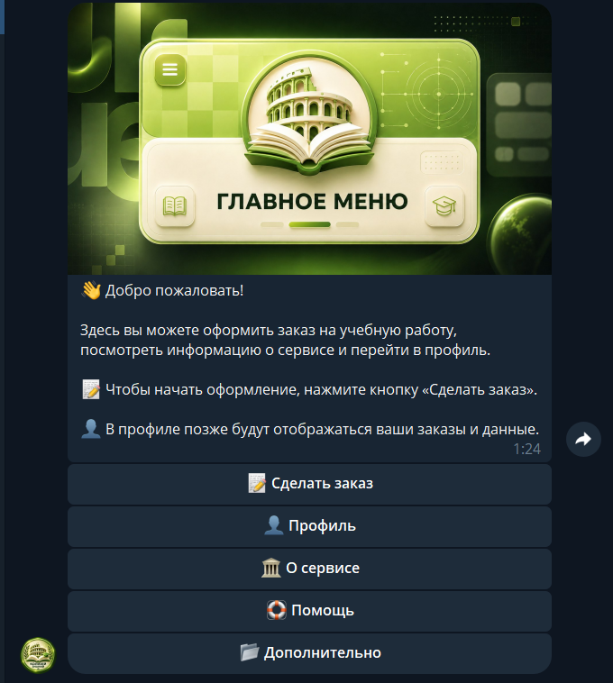
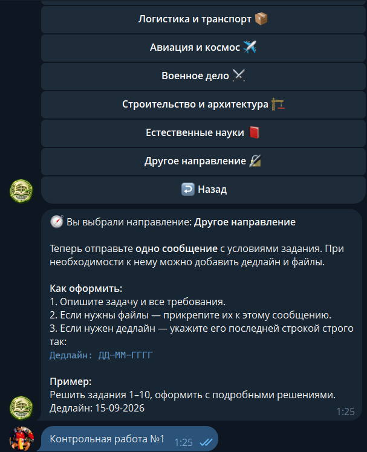
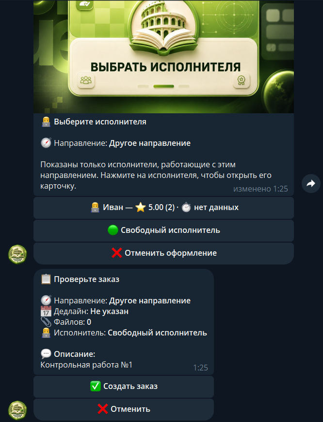

# Колизей Знаний

**Telegram-бот для оформления учебных заказов и общения заказчика с исполнителем**

От описания задачи и выбора исполнителя до согласования стоимости и работы над заказом — в Telegram.

[Открыть бота](https://t.me/ColiseumStudyBot) · [Исходный код](https://github.com/ddd44473/learning_help_bot)

## Для кого этот бот

«Колизей Знаний» рассчитан на три роли: заказчиков, которым нужна помощь с учебной задачей, исполнителей, принимающих и выполняющих заказы, и администраторов сервиса. Бот собирает информацию о задаче, помогает сторонам согласовать условия и сохраняет ход работы, чтобы взаимодействие не терялось в разрозненных чатах.

## Возможности

- **Оформление заказа:** выбор учебного направления, описание задания и, при необходимости, дедлайн и файлы.
- **Выбор исполнителя:** заказчик может выбрать исполнителя по карточке с направлениями, рейтингом и отзывами либо открыть заказ для свободного назначения. В этом режиме его получает первый подходящий исполнитель, который возьмёт заказ.
- **Обсуждение и стоимость:** исполнитель получает заказ и предлагает цену; переписка привязана к заказу и организована через бота.
- **Работа со статусами:** исполнитель обновляет состояние заказа, а заказчик получает уведомление и может подтвердить завершение или вернуть работу на доработку.
- **Профили и администрирование:** доступны отзывы и рейтинг исполнителей; административные инструменты включают управление пользователями и отдельными операциями сервиса.

## Интерфейс бота

<table>
  <tr>
    <td align="center" valign="top"></td>
    <td align="center" valign="top"></td>
    <td align="center" valign="top"></td>
  </tr>
  <tr>
    <td align="center"><em>Главное меню</em></td>
    <td align="center"><em>Создание заказа</em></td>
    <td align="center"><em>Карточка заказа</em></td>
  </tr>
</table>

## Как устроен проект

Бот написан на **Python 3.12** с **aiogram 3** и получает обновления Telegram через long polling. **SQLite** хранит пользователей, заказы, файлы и связанные с работой данные; доступ к базе выполняется асинхронно через `aiosqlite`.

Код разделён по назначению: `handlers/` обрабатывает команды и действия в Telegram, `keyboards/` формирует меню и кнопки, `states/` описывает этапы диалогов, `services/` содержит прикладные задачи, а `database/` — работу с данными и миграции. В `middlewares/` находятся общие обработчики событий, в `catalog/` — направления, в `tests/` — автоматические проверки.

Dockerfile собирает образ приложения; для запуска предусмотрены `compose.yaml` и локальный оверлей `compose.local.yaml`. Рабочий бот использует Telegram long polling, поэтому входящий HTTP-порт ему не требуется.

## Запуск и конфигурация

Рабочий экземпляр развёрнут на VPS и доступен в [Telegram](https://t.me/ColiseumStudyBot). Для собственной копии потребуются `BOT_TOKEN`, `ADMIN_IDS` и `MASTER_GROUP_ID`; конфиденциальные значения передаются через переменные окружения. Для сборки и запуска контейнера в проекте предусмотрены `Dockerfile` и Compose-конфигурации.

## Статус

Бот работает в Telegram. Автоматические тесты проходят.
